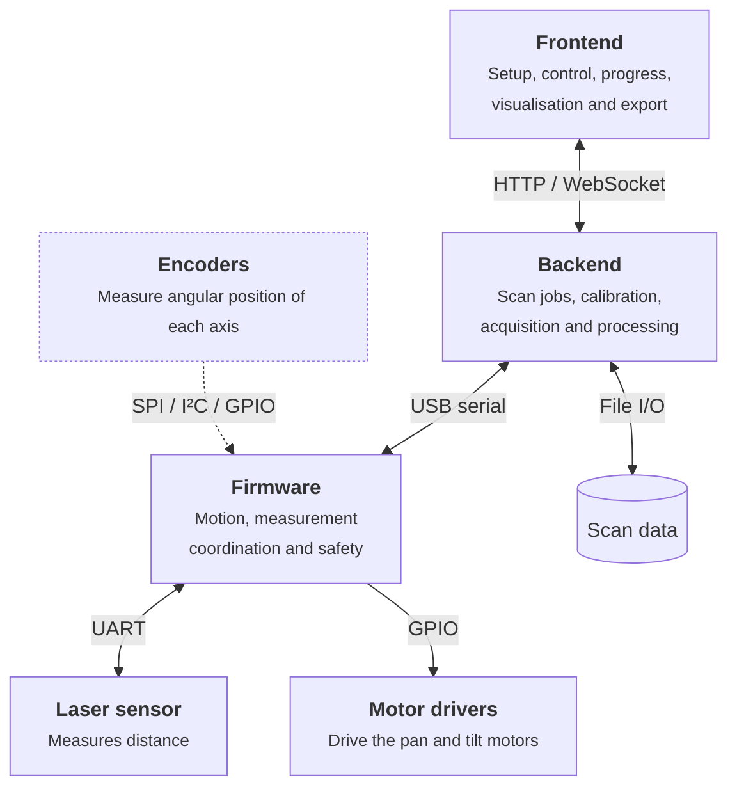

| Component | Technology | Runs on           |
| --------- | ---------- | ----------------- |
| Frontend  | React      | Browser           |
| Backend   | Python     | Raspberry Pi 4    |
| Firmware  | C/C++      | Raspberry Pi Pico |
